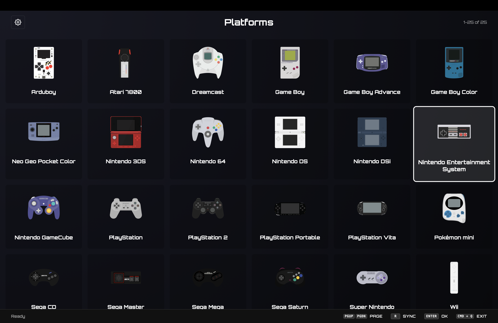
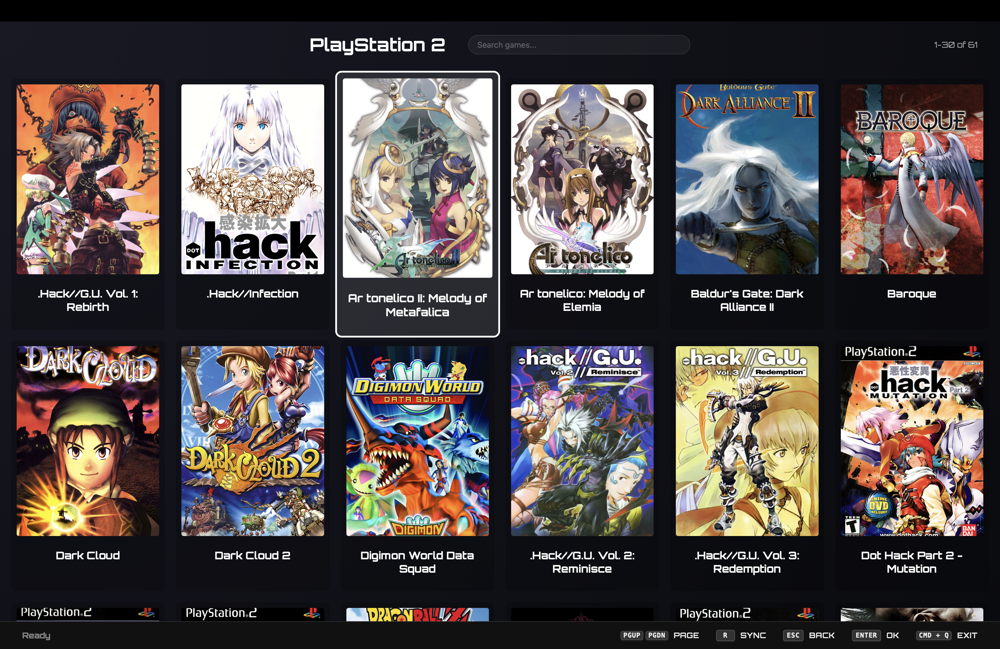
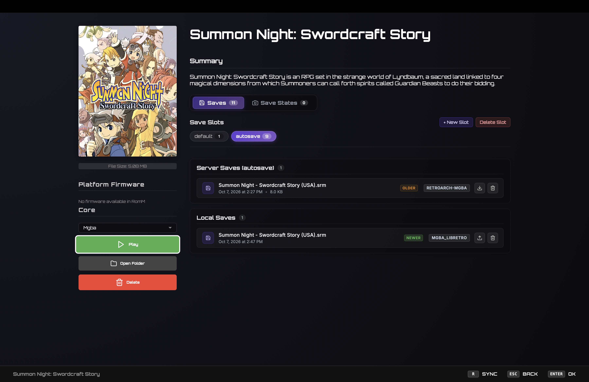

<p align="center">
  
  <br>
  <em>A seamless bridge between RomM and RetroArch for a console-like gaming experience.</em>
</p>

# Go-RomM-Sync

> [!IMPORTANT]
> This application is a client for synchronizing and playing games from your RomM library locally on your device. It is **not** intended for managing or adding new games to your self-hosted RomM instance. Please use the RomM web interface for administrative tasks.
>
> **Note:** This project is not affiliated with, endorsed by, or in any way officially connected with the [RomM project](https://github.com/rommapp/romm).
>
> **Supported RomM Version:** [5.3.0](https://github.com/rommapp/romm/releases/tag/5.3.0) or newer
>
> 📖 **[Project Wiki](https://github.com/zapturk/Go-RomM-Sync/wiki)**: Check out our wiki for setup guides, platform compatibility, and more!

Go-RomM-Sync is a desktop application built with Wails and React that synchronizes your RomM library with a local RetroArch installation. It provides a gaming-console-like experience with full controller navigation support, making it perfect for use with gamepads on a home theater setup.

## Features

- **Enhanced Metadata**: Fetches detailed game summaries, genres, and cover art directly from your RomM instance.
- **Library Management**: One-click download of ROMs to your local storage, organized by platform.
- **RetroArch Integration**: Launch games directly into RetroArch with automatic core detection and RetroAchievements support.
- **Spatial Navigation**: Full support for gamepad and keyboard navigation, with "sticky" focus that remembers your position as you browse.
- **Cross-Platform**: Designed to work on macOS, Linux, and Windows.

## Screenshots

<p align="center">
  
  <br>
  <em>Platform Selection Screen</em>
</p>

<p align="center">
  
  <br>
  <em>Game Selection for Game Boy Advance</em>
</p>

<p align="center">
  
  <br>
  <em>Game Detail Page with Server and Local Saves</em>
</p>

## Technology Stack

- **Backend**: Go with [Wails v3](https://wails.io/) for native OS integration.
- **Frontend**: React + TypeScript + Vite.
- **Styling**: Vanilla CSS for a lightweight, performant UI.
- **Navigation**: Norigin Spatial Navigation for console-like input handling.

## Development

### Developer Prerequisites

- Go 1.23+ installed on your system.
- Node.js 18+ installed on your system.
- NPM installed on your system.
- Wails v3 CLI (`wails3`) installed:
  ```bash
  go install github.com/wailsapp/wails/v3/cmd/wails3@latest
  ```

### Running Locally

To run the application in development mode with hot reloading:

```bash
wails3 dev
```

### Building

To build a binary for your current platform:

```bash
wails3 build
```

To create a production package (`.app` bundle on macOS, installer on Windows/Linux):

```bash
wails3 task package
```

#### Linux Specifics

For Linux distributions (like Ubuntu 22.04+), install the required WebKit and GTK development libraries:

```bash
# Install dependencies (Ubuntu/Debian)
sudo apt-get install libgtk-3-dev libwebkit2gtk-4.1-dev

# Build application
wails3 build
```

#### Android

Building for Android requires the Android SDK, Android NDK (e.g. NDK 26+), and JDK (e.g. OpenJDK 21).

Ensure your environment variables are configured:
```bash
export ANDROID_HOME="$HOME/Library/Android/sdk"   # macOS default (or ~/Android/Sdk on Linux)
export ANDROID_NDK_HOME="/path/to/android-ndk"
export JAVA_HOME="/path/to/jdk-21"
```

To build a debug APK (`bin/go-romm-sync.apk`):
```bash
wails3 task build:android
```

To build a signed release APK (`bin/go-romm-sync.apk`):
```bash
wails3 task package:android
```

## Installation

### Android

Download the latest `go-romm-sync-android.apk` from the [Releases page](https://github.com/zapturk/Go-RomM-Sync/releases) and install it on your Android device.

### macOS (Homebrew)

The easiest way to install Go-RomM-Sync on macOS is via Homebrew:

```bash
brew tap zapturk/homebrew-tap
brew install --cask go-romm-sync
```

### Windows (Scoop)

If you use [Scoop](https://scoop.sh/), you can install Go-RomM-Sync directly from the manifest in this repository:

```powershell
scoop install https://raw.githubusercontent.com/zapturk/Go-RomM-Sync/main/scoop/go-romm-sync.json
```

### Linux (Native Packages)

We provide native packages for major Linux distributions on our [Releases page](https://github.com/zapturk/Go-RomM-Sync/releases):

- **Debian / Ubuntu / Mint**: Download and install the `.deb` package.
  ```bash
  sudo apt install ./go-romm-sync_<version>_amd64.deb
  ```
- **Fedora / RHEL / openSUSE**: Download and install the `.rpm` package.
  ```bash
  sudo dnf install ./go-romm-sync-<version>-1.x86_64.rpm
  ```
- **Arch Linux**: Download and install the `.pkg.tar.zst` package:
  ```bash
  sudo pacman -U ./go-romm-sync-<version>-1-x86_64.pkg.tar.zst
  ```
  *(Alternatively, build from source using `go-romm-sync-arch-PKGBUILD` renamed to `PKGBUILD` and `makepkg -si`)*

### Manual Installation

Alternatively, you can download the latest release for your platform from the [Releases page](https://github.com/zapturk/Go-RomM-Sync/releases) and move the executable to your applications/bin directory.

## Setup and Usage

Please refer to the **[Setup and Usage Guide](https://github.com/zapturk/Go-RomM-Sync/wiki/Setup)** in the project wiki for detailed instructions on:
- First-time authentication and configuration.
- Selecting your RetroArch executable.
- Downloading and playing games from your RomM library.
- Synchronizing saves and states.

For a list of all supported emulators and platforms, see the **[Supported Platforms & Cores](https://github.com/zapturk/Go-RomM-Sync/wiki/Platforms)** page.

## Roadmap

- [x] **Save Syncing Management**: Bidirectional synchronization of saves and states between local storage and RomM.
- [x] **Add Pico-8 Support**: Add support for Pico-8 games.
- [ ] **Detailed Achievements**: View RetroAchievements progress and badges directly on the game page.
- [ ] **Advanced Filtering**: Filter games by genre, platform, or download status.
